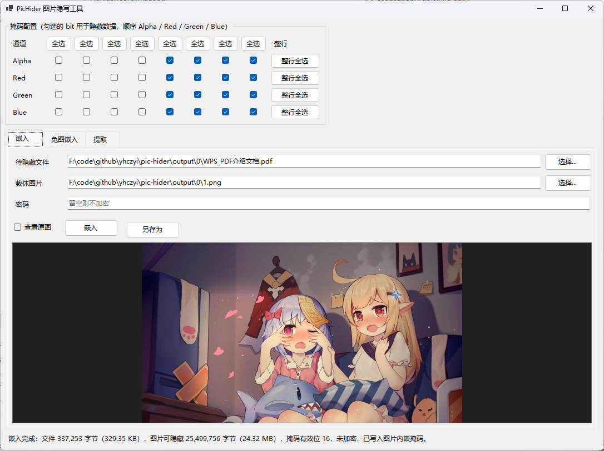
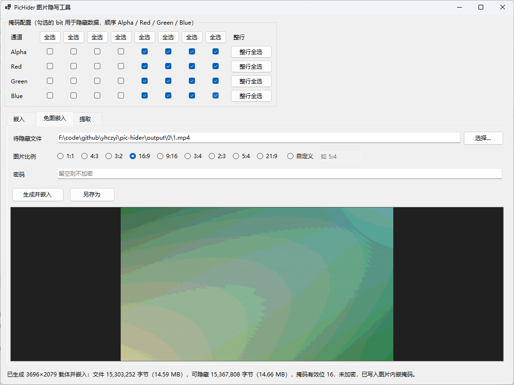
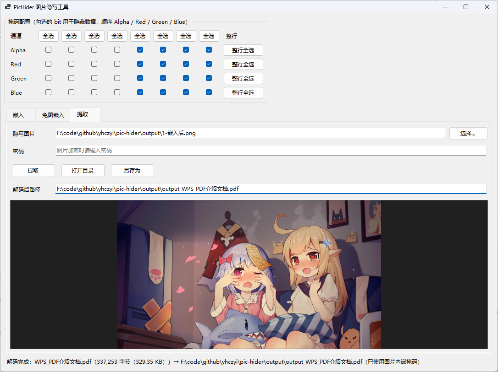
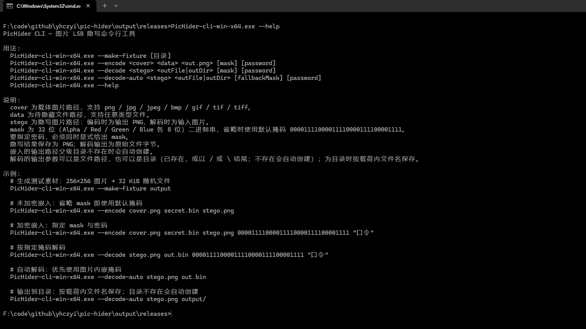

<div align="center">

# PicHider

**把任意文件藏进图片像素的低位，外观几乎无损。**

图片隐写工具 · 可自定义 32 位掩码 · 可选 AES-256-GCM 加密 · 内嵌自描述掩码


[功能特性](#功能特性) · [快速开始](#快速开始) · [命令行](#命令行使用) · [工作原理](#工作原理) · [数据格式](#数据格式) · [从源码构建](#从源码构建) · [已知限制](#已知限制与安全说明)

</div>

---

PicHider 是一款用 C# / .NET 10 编写的图片隐写（steganography）工具。它把任意类型的文件写进图片像素的最低位（LSB）。你既可以精细选择哪些位参与承载，也可以选择是否用密码加密。

> 一句话：选一张图、选一个文件、点一下，文件就成了图片里看不见的秘密。

项目同时提供 WinForms 图形界面和命令行工具。发布版是免安装的自包含单文件 exe，目标机器无需安装任何运行时：

| 可执行文件                 | 说明                         |
| -------------------------- | ---------------------------- |
| `PicHider-gui-win-x64.exe` | 图形界面版，双击即可使用     |
| `PicHider-cli-win-x64.exe` | 命令行版，适合脚本化与批处理 |

## 功能特性

| 分类     | 能力                                                                                              |
| -------- | ------------------------------------------------------------------------------------------------- |
| 隐写     | 任意类型文件嵌入图片；支持 png / jpg / jpeg / bmp / gif / tif / tiff 作为载体，结果固定保存为 PNG |
| 掩码     | 32 位逐位勾选；按列 / 按通道批量选择；默认使用每通道低 4 位（16 位/像素）                         |
| 自动解码 | 优先读取图片内嵌的自描述掩码；页脚缺失或损坏时回退到指定掩码                                      |
| 加密     | 可选 AES-256-GCM；PBKDF2-HMAC-SHA256（10 万次迭代）派生密钥；GCM 认证防篡改                       |
| 免图嵌入 | 按预设或自定义比例生成渐变载体，自动计算够用的最小尺寸                                            |
| 图形界面 | 三个页签共享同一套掩码矩阵；自动记住上次的路径、掩码、比例与密码输入                              |
| 命令行   | 单文件 exe，支持脚本调用                                                                          |

## 界面速览

主窗口有三个页签，顶部是三个页签共用的 32 位掩码矩阵：

| 页签         | 用途                                                            |
| ------------ | --------------------------------------------------------------- |
| **嵌入**     | 选择载体图片和待隐藏文件，可选密码，执行嵌入并预览 / 另存为 PNG |
| **免图嵌入** | 没有合适的载体图时，选择比例后自动生成渐变图并直接嵌入          |
| **提取**     | 选择隐写图片，输入密码（如有），解码还原原始文件                |





## 快速开始

### 下载发布版

从 [Releases](../../releases) 下载对应架构的 exe，解压后直接运行，无需安装 .NET：

- 图形界面：双击 `PicHider-gui-win-x64.exe`
- 命令行：在终端中运行 `PicHider-cli-win-x64.exe --help`

### 图形界面

1. 打开 **嵌入** 页签，选择一张载体图片和一个待隐藏文件。
2. 按需调整掩码矩阵；如果设置了密码，载荷会自动使用 AES-256-GCM 加密。
3. 点击“嵌入”，预览结果并另存为 PNG。
4. 需要还原时切换到 **提取** 页签，选择该 PNG（输入密码），点击“提取”。

没有合适的载体图时，使用 **免图嵌入**：选择 1:1、16:9 等比例或自定义比例，工具会自动生成一张尺寸足够的渐变图并完成嵌入。

### 命令行

见下方 [命令行使用](#命令行使用)。

## 命令行使用

发布后的 `PicHider-cli-win-x64.exe` 为自包含单文件，直接运行 `--help` 查看完整帮助：



### 用法

```text
PicHider-cli-win-x64.exe --make-fixture [目录]
PicHider-cli-win-x64.exe --encode <cover> <data> <out.png> [mask] [password]
PicHider-cli-win-x64.exe --decode <stego> <outFile|outDir> [mask] [password]
PicHider-cli-win-x64.exe --decode-auto <stego> <outFile|outDir> [fallbackMask] [password]
PicHider-cli-win-x64.exe --help
```

### 参数说明

- `cover`：载体图片路径，支持 png / jpg / jpeg / bmp / gif / tif / tiff。
- `data`：待隐藏文件路径，支持任意类型文件。
- `stego`：隐写图片路径；编码时为输出 PNG，解码时为输入图片。
- `mask`：32 位二进制串，对应 `Alpha / Red / Green / Blue` 各 8 位。省略时使用默认掩码 `00001111000011110000111100001111`。
- `password`：可选密码。**要指定密码，必须同时显式给出 `mask`**；空串表示不加密，空白字符是合法密码。
- 隐写结果固定保存为 PNG；解码输出为原始文件字节。
- `--encode` 的输出文件父级目录不存在时会自动创建。
- `--decode` / `--decode-auto` 的输出参数可以是文件，也可以是目录：目录已存在，或以 `/`、`\` 结尾；目录不存在时会创建，并按载荷内文件名保存。
- `--decode-auto` 优先使用图片内嵌的掩码，缺失或损坏时才回退到 `fallbackMask`。
- `--make-fixture` 生成测试素材：一张 256×256 的渐变图 `fixture.png` 和一个 32 KiB 的随机文件 `secret.bin`。

### 示例

```bash
# 生成测试素材：256×256 图片 + 32 KiB 随机文件
PicHider-cli-win-x64.exe --make-fixture output

# 未加密嵌入：省略 mask 即使用默认掩码
PicHider-cli-win-x64.exe --encode cover.png secret.bin stego.png

# 加密嵌入：指定 mask 与密码
PicHider-cli-win-x64.exe --encode cover.png secret.bin stego.png 00001111000011110000111100001111 "口令"

# 按指定掩码解码
PicHider-cli-win-x64.exe --decode stego.png out.bin 00001111000011110000111100001111 "口令"

# 自动解码：优先使用图片内嵌掩码
PicHider-cli-win-x64.exe --decode-auto stego.png out.bin

# 输出到目录：按载荷内文件名保存；目录不存在会自动创建
PicHider-cli-win-x64.exe --decode-auto stego.png output/
```

### 退出码

| 退出码 | 含义                                                 |
| ------ | ---------------------------------------------------- |
| `0`    | 成功                                                 |
| `1`    | 隐写业务错误，如容量不足、密码错误、未找到隐藏数据等 |
| `2`    | 用法错误或未预期异常                                 |

## 工作原理

### LSB 隐写

图片的每个像素是 32 位整数 `0xAARRGGBB`，拆成 `Alpha / Red / Green / Blue` 各 8 位。改写这些通道的低位对颜色影响很小——传统 LSB 隐写只改最低 1 位；PicHider 则把“哪些位参与承载”做成可配置的 32 位掩码，默认取每个通道的低 4 位。

| 改动位数     | 单个通道最大变化 | 说明                           |
| ------------ | ---------------- | ------------------------------ |
| 1 位         | 1/255            | 几乎不可见                     |
| 4 位（默认） | 15/255（约 6%）  | 在渐变、自然照片中通常仍不明显 |

嵌入和提取遵循同一套规则，只是方向相反。规则只有两条：**哪些像素位承载数据（掩码）**，以及**按什么顺序读写这些位（扫描顺序）**。

| 方向 | 处理流程                                                  |
| ---- | --------------------------------------------------------- |
| 嵌入 | 文件字节按 `bit7 → bit0` 拆成比特流，再按掩码写入像素低位 |
| 提取 | 按掩码从像素低位读出比特流，再拼回文件字节                |

例如字节 `0x50`（二进制 `0101 0000`）会依次占用 8 个被掩码选中的像素位，写入顺序是 `0 1 0 1 0 0 0 0`；提取时按同样顺序读回，即可还原这个字节。

Payload 结构、加密与掩码页脚见 [数据格式](#数据格式)。

### 掩码：哪些位承载数据

32 位掩码从左到右对应 `bit31 → bit0`，即 `Alpha → Red → Green → Blue`，每通道 `bit7 → bit0`：

```text
 b31 ...... b24 | b23 ...... b16 | b15 ...... b8 | b7 ...... b0
     Alpha            Red             Green            Blue
```

`1` 表示承载数据，`0` 表示保持原样。默认掩码只取每通道低 4 位，兼顾容量与画质（不能全为 0）：

```text
00001111000011110000111100001111   // 每像素 16 位，PopCount = 16
```

### 读写顺序：从左上角开始逐行填充

确定掩码后，还要约定按什么顺序把数据填进像素。可以把它想成在图片上“写字”：**从左到右、从上到下，一行写完再换下一行**。

具体分三层：

1. **像素之间**：从左上角 `(0,0)` 开始向右，当前行写满后换到下一行。
2. **像素内部**：按 `Alpha → Red → Green → Blue` 的顺序处理各通道；每个通道内从高位到低位，只填掩码选中的位。
3. **字节内部**：从最高位开始拆，例如 `0101 0000` 按 `0 1 0 1 0 0 0 0` 的顺序写入。

默认掩码下，每个像素提供 16 个可写位置，依次承载 `A3 A2 A1 A0 | R3 R2 R1 R0 | G3 G2 G1 G0 | B3 B2 B1 B0`。

**例子**：Payload 以魔数 `"PHPL"`（`0x50 0x48 0x50 0x4C`）开头。默认掩码下每个像素能装 16 位，所以前两个像素刚好装下这 4 个字节。

第 1 个像素装入 `0x50` 和 `0x48`，只需看各通道的低 4 位：

```text
              bit3 bit2 bit1 bit0
  Alpha        0    1    0    1  ┐
  Red          0    0    0    0  ┘ 0101 0000 = 0x50 = 'P'
  Green        0    1    0    0  ┐
  Blue         1    0    0    0  ┘ 0100 1000 = 0x48 = 'H'
```

第 2 个像素装入 `0x50` 和 `0x4C`，读出 `'P' 'L'`，连起来就是 `"PHPL"`。

数据写完后即停止。容量允许时，末尾还会写入一段掩码页脚（见 [内嵌掩码页脚](#内嵌掩码页脚)）；解码时按同样的掩码和顺序读取，因此不需要额外保存顺序信息。

### 容量估算

可用位数由像素数与掩码有效位决定：

```text
可用字节 ≈ ⌊像素数 × 掩码 PopCount ÷ 8⌋
```

需要写入内嵌掩码页脚时，还要预留最后 80 个像素（默认掩码下 160 字节）；实际可嵌入的数据量再减去头部与描述信息的开销。

默认掩码（16 位/像素）下的粗略容量：

| 载体尺寸    | 像素数    | 可隐藏数据（约） |
| ----------- | --------- | ---------------- |
| 800 × 600   | 480,000   | 937 KiB          |
| 1920 × 1080 | 2,073,600 | 3.95 MiB         |
| 3840 × 2160 | 8,294,400 | 15.8 MiB         |

## 数据格式

### Payload 字节布局

所有多字节整数均使用**大端序**。

**固定前缀（6 字节）**

| 偏移 | 长度 | 内容                                          |
| ---- | ---- | --------------------------------------------- |
| 0    | 4    | 魔数 `"PHPL"`（`0x50 0x48 0x50 0x4C`）        |
| 4    | 1    | 格式版本，当前为 `1`                          |
| 5    | 1    | 标志位，`bit0 = 1` 表示已加密，其余位必须为 0 |

**未加密（密码为空）**

| 偏移   | 长度 | 内容                                                                      |
| ------ | ---- | ------------------------------------------------------------------------- |
| 0      | 6    | 固定前缀（魔数 / 版本 / 标志，标志 bit0 = 0）                             |
| 6      | 4    | profile 长度（= profile 明文字节数）                                      |
| 10     | P    | profile 明文：UTF-8 串 `"{fileSize},{fileName}"`，例如 `12345,secret.bin` |
| 10 + P | N    | 文件原始字节                                                              |

**已加密（密码非空）**

| 偏移   | 长度   | 内容                                            |
| ------ | ------ | ----------------------------------------------- |
| 0      | 6      | 固定前缀（魔数 / 版本 / 标志，标志 bit0 = 1）   |
| 6      | 16     | PBKDF2 盐（随机）                               |
| 22     | 12     | profile GCM nonce（随机）                       |
| 34     | 12     | content GCM nonce（随机）                       |
| 46     | 4      | profile 字段长度（明文长度 + 16B GCM 认证 tag） |
| 50     | P      | profile 密文 + 16B GCM 认证 tag                 |
| 50 + P | N + 16 | content 密文 + 16B GCM 认证 tag                 |

GCM 的 AAD（附加认证数据）为头部字节，即从魔数到 profile 长度字段为止，防止头部被篡改。

**加密参数**

| 参数      | 值                                                 |
| --------- | -------------------------------------------------- |
| 密钥派生  | PBKDF2-HMAC-SHA256，100,000 次迭代                 |
| 盐 / 密钥 | 16 字节盐，派生 32 字节密钥（AES-256）             |
| 加密算法  | AES-256-GCM，12 字节 nonce，16 字节认证标签        |
| 密码编码  | UTF-8；`null` 或空串表示不加密，空白字符是合法密码 |

### 内嵌掩码页脚

为了忘记掩码也能解码，容量允许时编码器会在图片末尾写入一份自描述的掩码。页脚的读取规则固定，不依赖 Payload 掩码：

- 位置：行优先顺序的**最后 80 个像素**。
- 载体位：每个像素 **Blue 通道的 bit0**（`0x00000001`）。
- 容量：80 bit = 10 字节，每像素 1 bit，字节内高位在前。

| 偏移 | 长度 | 内容                                   |
| ---- | ---- | -------------------------------------- |
| 0    | 4    | 魔数 `"PHMF"`（`0x50 0x48 0x4D 0x46`） |
| 4    | 1    | 页脚版本，当前为 `1`                   |
| 5    | 4    | 32 位掩码（大端）                      |
| 9    | 1    | 校验和：前 9 字节逐字节 XOR            |

读取时依次校验长度、魔数、版本、校验和，且掩码不能为 0。

写入条件是 Payload 完全不侵入最后 80 个像素（`payloadBits <= (S - 80) × k`）。图片像素数不超过 80 或 Payload 占用到页脚区域时不写页脚；这种情况下编码器会让旧页脚失效，避免解码时误读上一次嵌入的掩码。

解码时优先使用内嵌掩码；页脚缺失或损坏则回退到外部指定掩码。**密码错误不会触发回退**，而是直接报错，避免把认证失败误判成掩码不对。

## 从源码构建

### 环境要求

- Windows 10 / 11
- [.NET 10 SDK](https://dotnet.microsoft.com/download)
- PowerShell 5.1+（仅打包脚本需要）

受 `System.Drawing.Common` 与 WinForms 限制，Core / App / CLI 均以 `net10.0-windows` 为目标框架，构建与运行都需要 Windows。

### 构建与运行

```bash
git clone https://github.com/yhczyi/pic-hider.git
cd pic-hider

# 构建整个解决方案
dotnet build PicHider.sln -c Release

# 运行图形界面
dotnet run --project src/PicHider.App -c Release

# 运行命令行
dotnet run --project src/PicHider.Cli -c Release -- --help
```

### 运行自检

`tests/PicHider.Checks` 是一个不依赖测试框架的控制台自检程序，覆盖掩码解析、加解密、嵌入 / 解码往返、容量计算、JPEG 载体、页脚与异常路径：

```bash
dotnet run --project tests/PicHider.Checks -c Release
```

全部通过时退出码为 `0`，否则为 `1`，并逐项打印 `[PASS]` / `[FAIL]`。

### 打包发布版

脚本以自包含、单文件方式发布，产物输出到 `output/releases`：

```powershell
# 默认构建 win-x64
powershell -ExecutionPolicy Bypass -File scripts/build-releases.ps1

# 指定架构
powershell -ExecutionPolicy Bypass -File scripts/build-releases.ps1 -Architectures win-x64,win-arm64
```

产物命名为 `PicHider-<gui|cli>-<arch>.exe`。

## 目录结构

```text
PicHider.sln
src/
  PicHider.Core/         隐写核心库
    ByteSize.cs          字节数格式化
    CoverGenerator.cs    按比例生成渐变载体，自动计算尺寸
    ImageUtil.cs         统一加载为 32bppArgb，及时释放文件句柄
    LsbDecoder.cs        分阶段逐位读取、校验、解密、写文件
    LsbEncoder.cs        组装 Payload、逐位写入、页脚写入 / 失效
    Mask.cs              32 位掩码解析 / 格式化 / PopCount
    MaskFooter.cs        末尾 80 像素的内嵌掩码页脚
    PayloadCrypto.cs     PBKDF2 + AES-256-GCM
    ProfileCodec.cs      "{fileSize},{fileName}" 编解码
    StegoException.cs    业务异常与错误码
  PicHider.App/          WinForms 界面
    MainForm.cs          主窗口与三个页签逻辑
    MainForm.AutoCover.cs 免图嵌入（比例选择与载体生成）
    UiStateStore.cs      本地界面状态缓存
    Program.cs           入口
  PicHider.Cli/          命令行工具
tests/
  PicHider.Checks/       控制台自检套件
scripts/
  build-releases.ps1     发布 GUI / CLI 单文件 exe
docs/
  screenshots/           界面与命令行截图
```

格式逻辑全部收敛在 `PicHider.Core`，界面与 CLI 只负责调用；其他 .NET 项目也可以直接引用 Core 复用嵌入 / 提取流程。

## 已知限制与安全说明

- **必须保持无损格式。** 隐写结果是 PNG；再次用 JPEG 压缩、缩放、裁剪、格式转换，或上传到会二次压缩图片的平台，都可能破坏隐藏数据。请保留原始 PNG。
- **LSB 隐写不具备鲁棒性。** 它适合“看起来是一张普通图片”的场景，不是抗压缩水印，也无法抵抗专门的隐写分析。加密保护的是内容机密性与完整性，不隐藏“图片中存在数据”这一事实。
- **默认掩码包含 Alpha 低位。** 对透明度敏感的场景，建议手动取消 Alpha 行的勾选，只用 RGB 通道；否则像素的 Alpha 可能在 240–255 之间变化，导致轻微透明。
- **未加密时元数据可见。** profile 中的原始文件名与文件大小是明文；需要隐藏这些信息时请设置密码。
- **图形界面会在本地缓存输入。** 为了记住上次的路径、掩码、比例与密码，界面会把状态写入项目目录或程序目录下的隐藏文件夹 `.pic-hider/state.json`，密码以明文保存。共用电脑上请谨慎使用，可随时删除该文件夹清除记录。
- **多帧图片按单帧处理。** 动图 GIF、多页 TIFF 等会按第一帧 / 第一页读取。
- **大文件受内存与尺寸限制。** 载荷会整体读入内存；免图嵌入的自动尺寸上限为长边 8192 像素、总像素 4000 万，超出会报容量不足。
- **合法使用。** 请仅对自己拥有权利的文件和图片使用本工具，并遵守所在地区的法律法规。

## 贡献

欢迎通过 [Issues](../../issues) 反馈问题、提出建议，或直接提交 Pull Request。提交前请运行自检套件并确保全部通过。

## 许可证

本项目基于 [MIT License](LICENSE) 开源，Copyright © 2026 yhczyi。
